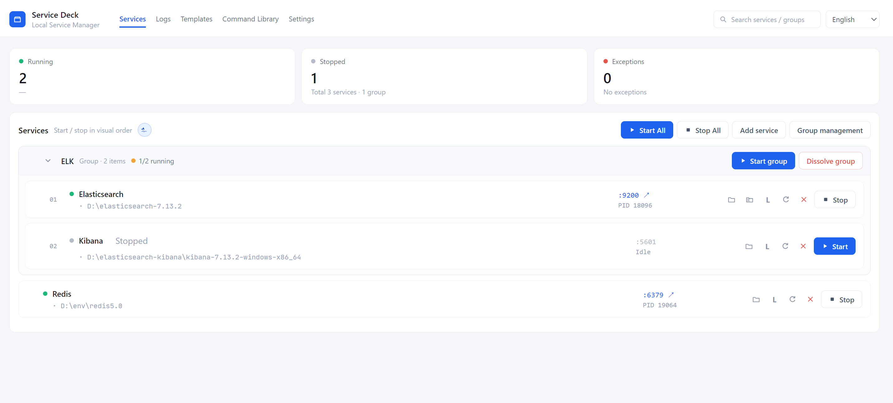
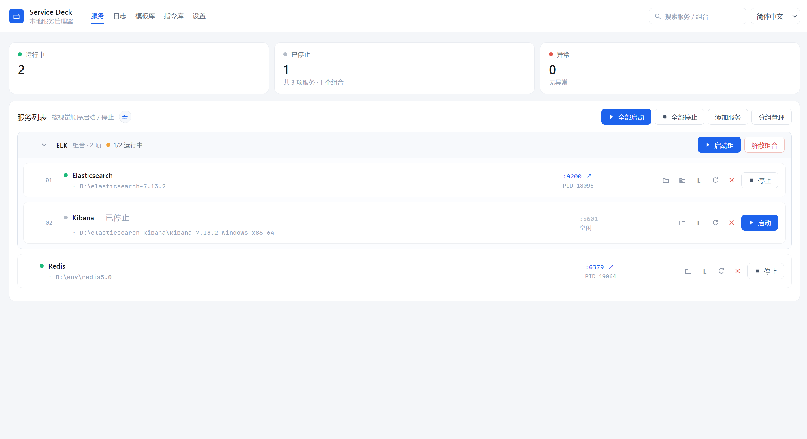

# devstack — 跨平台本地服务管理器

<p align="center">
  <a href="https://github.com/leo-z-z-z/devstack/stargazers">
    
  </a>
  <a href="https://github.com/leo-z-z-z/devstack/network/members">
    
  </a>
  <a href="https://github.com/leo-z-z-z/devstack/issues">
    
  </a>
  <a href="https://github.com/leo-z-z-z/devstack/pulls">
    
  </a>
  <a href="LICENSE">
    
  </a>
</p>

<p align="center">
  跨平台（Windows / macOS / Linux）本地服务管理器 · Electron + React + TypeScript · 统一起停、查状态、看日志
</p>

<p align="center">
  <a href="locales/zh-CN/README.md">简体中文</a>
  ｜
  <a href="locales/zh-TW/README.md">繁體中文</a>
  ｜
  <a href="locales/en/README.md">English</a>
  ｜
  <a href="locales/ja/README.md">日本語</a>
  ｜
  <a href="locales/ko/README.md">한국어</a>
  ｜
  <a href="locales/fr/README.md">Français</a>
  ｜
  <a href="locales/es/README.md">Español</a>
  ｜
  <a href="locales/de/README.md">Deutsch</a>
  ｜
  <a href="locales/pt/README.md">Português</a>
</p>

## 关于

devstack 是一个面向本地中间件与服务的桌面命令面板，支持服务启停、分组串行编排、实时状态探测与端口冲突告警。适合本地开发环境，把 Redis、MySQL、PostgreSQL、Elasticsearch、Kibana、MinIO 等各种服务统一起停、查状态、看日志，本地开发环境按需启动。

软件不下载、不解压、不安装任何中间件；所有组件由用户自行安装，软件仅读取用户指定的安装目录并下发启停命令。配置与日志仅落在本地，不联网上传任何数据。

## 特性

- **统一起停**：一键启动 / 停止 / 重启 / 打开安装目录，命令与参数可自定义
- **状态实时可见**：纯 TCP 端口探测 + owning PID 归属判定，运行中 / 已停止 / 异常三态清晰展示
- **端口冲突拦截**：展示占用者进程名与 PID，服务未启动却被占用时启动前拦截
- **端口直达**：端口列为可点击链接，用系统默认浏览器打开（可由 `webUrl` 覆盖）
- **分组串行编排**：用户手动创建分组，组内成员从上到下串行启动，停止逆序；未分组服务并行发起
- **拖拽排序**：主面板唯一的顺序调整方式，组卡整块拖动，组内成员仅限组内拖动
- **模板系统**：一个组件一个 JSON 模板，放入 `presets/` 目录即可识别，首次新建服务时一次性填充，与后续配置脱钩
- **日志查看**：命令 stdout/stderr 捕获 + 指定日志文件 tail，支持单独或同时启用，落盘到本地日志文件
- **二次确认**：全部启动 / 全部停止 / 删除服务均需确认，弹窗写明影响范围与执行顺序
- **国际化**：9 种语言（简体中文 / 繁體中文 / English / 日本語 / 한국어 / Français / Español / Deutsch / Português），顶栏切换即时生效

## 应用截图




## 技术栈

| 层   | 技术                    | 用途                              |
| --- | --------------------- | ------------------------------- |
| 主进程 | Electron (Node.js)    | 进程托管、端口探测、配置读写、日志 tail          |
| 渲染层 | React 18 + TypeScript | 界面与状态订阅，Vite 构建                 |
| 打包  | Electron-builder      | MSI / NSIS / dmg / AppImage 分发包 |
| 配置  | `services.yaml`       | 服务定义、分组、顺序、设置                   |
| 模板  | `presets/*.json`      | 单组件模板，6 顶层键                     |

## 快速开始

### 环境要求

- Node.js ≥ 18（推荐 20+）
- Git
- 本地已安装你要管理的中间件（Redis / MySQL / PostgreSQL / Elasticsearch 等）

### 安装与运行

```bash
# 克隆仓库
git clone https://github.com/leo-z-z-z/devstack.git
cd devstack/app

# 安装依赖
npm install

# 启动开发模式（Vite + Electron）
npm run dev

# 仅运行 Web 调试（不启 Electron）
npm run dev:web
```

### 构建与打包

```bash
# 构建渲染层 + 编译主进程
npm run build

# 启动已构建的应用
npm start

# 打包为分发目录
npm run pack

# 完整打包安装包（MSI / NSIS / dmg 等）
npm run dist
```

构建产物输出至 `dist/` 或 `release/`，可直接分发给最终用户。

### 数据与配置目录（运行时）

首次运行后，配置与日志落在平台标准位置，目录名为 `devstack`：

| 平台 | 路径 |
|------|------|
| Windows | `%APPDATA%\devstack\` |
| macOS | `~/Library/Application Support/devstack/` |
| Linux | `~/.devstack/` |

子目录：

- `services.yaml` — 服务定义、分组、顺序、设置（手动编辑也生效，重启读取）
- `presets/` — 用户自定义 JSON 模板
- `scripts/` — 指令库脚本（.bat/.cmd/.ps1/.sh，按文件夹组织）
- `logs/` — 服务日志与软件运行日志

> 开发期可通过环境变量 `DEVSTACK_DATA_DIR` 将数据目录隔离到任意位置，避免与已运行实例抢占资源。

## 项目结构（app/）

```
app/
├── .gitignore          # Git 忽略（node_modules / dist-electron / .env 等）
├── .gitattributes      # 换行符规范（源码统一 LF）
├── LICENSE             # Apache-2.0
├── package.json        # 依赖与脚本
├── package-lock.json
├── tsconfig.json       # 渲染层 TS 配置
├── tsconfig.electron.json  # 主进程 TS 配置
├── vite.config.ts      # Vite 配置
├── scripts/            # 辅助脚本（启动、校验、i18n 键注册等）
├── src/
│   ├── main/           # Electron 主进程（进程托管、端口探测、配置、日志）
│   ├── renderer/       # React 渲染层（Vite）
│   └── shared/         # 共享类型
└── test/               # 冒烟、模板、路径、状态语义等测试
```

## 随包组件模板

随包自带 9 个组件模板（可直接使用或复制修改）：

| 模板 ID | 组件 | 默认端口 |
|---------|------|----------|
| `redis` | Redis | 6379 |
| `mysql` | MySQL | 3306 |
| `postgresql` | PostgreSQL | 5432 |
| `elasticsearch` | Elasticsearch | 9200 |
| `logstash` | Logstash | 9600 |
| `kibana` | Kibana | 5601 |
| `rocketmq-nameserver` | RocketMQ NameServer | 9876 |
| `rocketmq-broker` | RocketMQ Broker | 10911 |
| `minio` | MinIO | 9000 |

## 贡献

本项目仍在持续更新之中，欢迎您参与。

- 问题反馈：请提交 [Issues](https://github.com/leo-z-z-z/devstack/issues)，描述复现步骤与环境信息
- 功能建议：欢迎在 Issues 中提出新组件模板、新平台支持或交互优化建议
- 代码贡献：Fork 仓库后提交 Pull Request，请保持提交信息采用惯例式提交（如 `feat:` / `fix:` / `docs:`）

## 许可证

本项目基于 [Apache License 2.0](./LICENSE) 开源。
